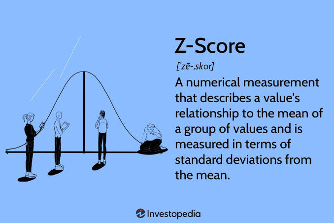
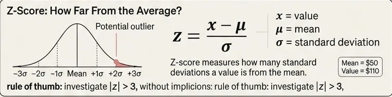
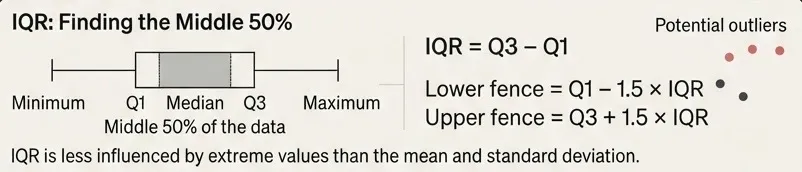
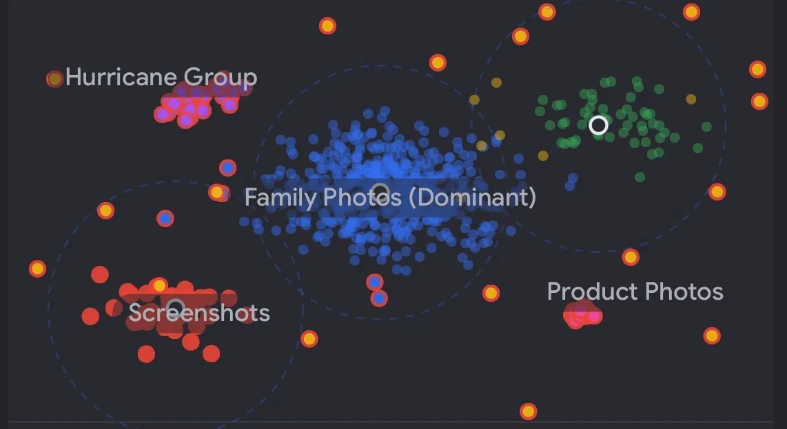

#Day 6 : Outliers - What do I do when there are extremes

With outliers nothing is actually missing . everything is there but something just does not look right . 
Imagine you have thousand invoices at NVIDIA 
- Invoice amounts are within a normal range 
- Date follow expected formats 
- Each invoice contains a few line items 
- Every invoice is from a bank with in America - Chase Bank , Bank of America 

Then one invoice appears with :
$5,000,000,000 - of course at NVIDIA , these are normal figures but from the Central Bank of China .

Nothing is missing . But that Location data is unusual . That is what is called Outliers .

**But is an Outlier always a Mistake**

Not necessarily.

That $5,000,000,000  invoice with a Chinese bank  could be:

❌ A typing error.

Or it could be:

✅ A legitimate transaction from a major customer through the Bank of China.

That 300-page document?

❌ It could be a system error where pages were duplicated.

Or:

✅ It could genuinely be a large annual report.

This is why we shouldn’t automatically delete unusual data.

First, we need to identify it. Then, we need to understand it.

**How do We find Something Unusual?**

For numerical data , two common methods are :
1. **Z-Score **

It considers the average and how spread out the data is. For example, if most invoices are around $2,000, an invoice worth $1,000,000 would likely have a very large Z-score.

-A common rule is that values with a Z-score greater than 3 or less than -3 may deserve investigation.-

2. **Interquartile range**

IQR takes a slightly different approach .
Instead of focusing on the average , it looks ate the middle of the data ( the 50%). It finds the typical range where most observations sit . For examples at JKC probably the average consumer spends 3000 ksh in a day at the shop . Anything  far from the range will be flagged as unusual .
Think of it like looking at a Yoga stadium  . You don't focus on the average posture of everyone .You look the the pose most people are assuming  ad notice that everyone  is seated in the lotus pose but one person is lying down . 

That is the intuition behind IQR

# Outliers in Unstructured Data

I thought outliers are limited to numbers . Imagine you have 100,000 images collected from the internet . Most images are bones photos , but the data set also contains :
- Hurricane images 
- Family photos 
- Screenshots
- Duplicate Images 
- Completely unrelated images 

There will almost not be a column saying:
 outlier - yes 

Instead , we can use techniques such as **clustering** to find groups of similar items .
  
  For example , **K - means clustering** can group imges based on their extracted features .
  

  If a small cluster is completely different from the dominant group, it deserves investigation. But again, being unusual doesn’t automatically mean it’s bad data.

A hurricane image might be:

Useful if we’re building a disaster-detection model

Irrelevant if we’re building a family-photo classifier

# What Can We Do With These Outliers?

Once we’ve identified unusual or irrelevant data, we can:

**Delete it**
→ If it’s clearly unrelated to the task.

**Domain filter it**
→ Keep only data that belongs to the problem we’re solving.

**Deduplicate it**
→ Remove repeated copies of the same image, document, or record.

**Keep it**
→ If the unusual data represents something our model actually needs to learn.

This is especially important when building AI systems from large collections of web data, images, documents, or other unstructured sources.

**Summary :**
 An outlier isn’t defined only by being numerically extreme. Sometimes it’s simply data that doesn’t belong to the pattern or domain you’re trying to learn.

**Spotting valid anomalies versus actual noise is critical when building robust LLM ingestion pipelines. Great framing on why schema validation alone isn't enough to catch these edge cases.** - was a comment I want to understand 

**Plain English**
this quote means: When feeding real-world data into an AI system, basic automated rule-checks aren't enough—you have to distinguish between genuine, unusual edge cases (which the AI needs to learn from) and broken garbage data (which will confuse it).

**Here is what each part of the statement means in the context of data engineering and AI:**

**"LLM ingestion pipelines"**: The automated assembly line that collects, cleans, and formats raw data (like PDFs, websites, or databases) before feeding it to a Large Language Model.

**"Valid anomalies versus actual noise"**:

**Valid anomaly**: Unusual data that is still real and meaningful (e.g., a legitimate 50-page legal clause in a dataset of 1-page contracts, or a valid product priced at $0.00 during a free promo). You want to keep this so the AI handles rare situations properly.

**Actual noise**: Corrupted or junk data (e.g., garbled text from a broken web scraper, "N/A" errors, or duplicate boilerplate footers). You want to filter this out so it doesn't degrade the AI's accuracy.

**"Why schema validation alone isn't enough"**: A schema is a strict structural checklist (e.g., "Does this field contain text? Is the price a number?"). A schema will happily pass a scraped article whose text is "404 Page Not Found" because, technically, that is valid text. Conversely, a strict schema might accidentally reject a valid anomaly just because it looks unusual.

**How this connects to what I am  learning**
This is literally why Pandas and Matplotlib are so important before jumping into Machine Learning. A rigid code rule (schema) checks data blindly, whereas using Pandas to inspect distributions and Matplotlib to plot outliers lets you visually see what is broken noise versus what is an interesting, real-world outlier.

